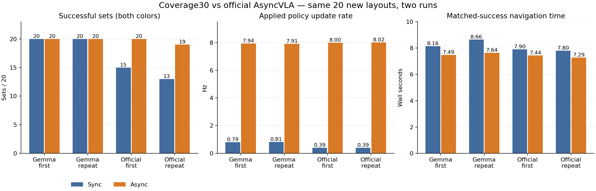
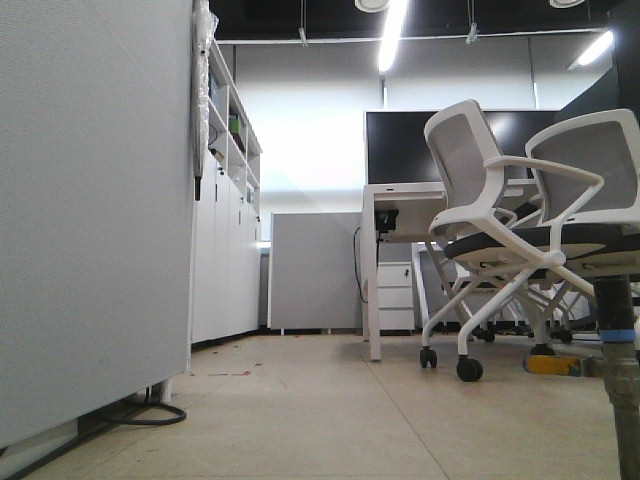
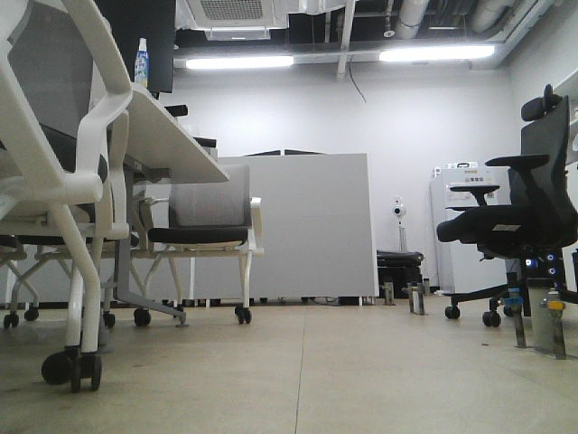

# AsyncVLA-Gemma-LIMO

Gemma 기반 AsyncVLA 비동기 추론 구조 및 ROS 2 기반 AgileX LIMO Pro 실물 로봇 적용

## 목차

- [1. 데이터셋 및 실험 환경](#1-데이터셋-및-실험-환경)
- [2. 입력 데이터 및 모델 구성](#2-입력-데이터-및-모델-구성)
- [3. 전체 처리 과정](#3-전체-처리-과정)
- [4. Gemma 기반 VLA 학습](#4-gemma-기반-vla-학습)
- [5. AsyncVLA Slow / Fast 구조](#5-asyncvla-slow--fast-구조)
- [6. Gazebo Sync / Async 비교 실험](#6-gazebo-sync--async-비교-실험)
- [7. 실제 이미지 기반 평가](#7-실제-이미지-기반-평가)
- [8. ROS 2 및 LIMO Pro 통합](#8-ros-2-및-limo-pro-통합)
- [9. LIMO Pro 실물 주행 실험](#9-limo-pro-실물-주행-실험)
- [10. 결과 및 한계](#10-결과-및-한계)
- [11. 현재 상태 및 향후 계획](#11-현재-상태-및-향후-계획)

---

## 프로젝트 개요

Vision-Language-Action(VLA) 모델은 이미지와 자연어 명령을 입력받아 로봇의 행동을 직접 생성할 수 있지만, 대규모 멀티모달 모델의 높은 추론 지연으로 인해 실제 로봇 제어에서는 최신 관측을 즉시 반영하기 어렵다는 문제가 있다.

본 프로젝트에서는 AsyncVLA의 **Slow VLA / Fast Edge Adapter** 구조를 기반으로 Gemma 계열 멀티모달 모델을 모바일 로봇 행동 생성 pipeline에 연결하였다.

Slow VLA는 RGB 이미지와 자연어 명령으로 semantic/action feature를 생성하고, Fast Edge Adapter는 해당 feature와 최신 RGB observation을 함께 사용하여 미래 trajectory를 빠르게 갱신한다.

최종적으로 해당 구조를 ROS 2 기반의 **AgileX LIMO Pro**와 연결하여 다음 항목을 검증하는 것을 목표로 한다.

- Gemma 기반 multimodal representation과 Action Adapter 연결
- AsyncVLA Slow / Fast inference 구조 구현
- Teacher feature distillation 기반 Gemma student 학습
- Sync / Async 구조의 trajectory update rate 비교
- Observation freshness와 inference latency 분석
- ROS 2 기반 실시간 camera / command pipeline 구축
- Robot-local Safety Guard 구성
- AgileX LIMO Pro 실물 로봇 적용

현재 **Model → ROS 2 → Safety Guard → LIMO Pro 실제 구동**까지 연결한 상태이며, 실제 환경에서 자연어 기반 목표 도착과 반복적인 Sync / Async 비교 실험은 진행 중이다.

---

# 1. 데이터셋 및 실험 환경

본 프로젝트에서는 Gemma 기반 VLA를 학습하고 평가하기 위해 **RECON/GNM, LeLaN, HuRoN** 공개 데이터셋을 사용하였다.

공식 AsyncVLA / OmniVLA 계열 모델의 action representation을 teacher로 활용하여 Gemma 기반 student model이 navigation에 필요한 semantic/action feature를 학습하도록 구성하였다.

본 프로젝트는 원 AsyncVLA 논문의 전체 학습 환경을 그대로 재현하는 것이 아니라, **공개 데이터와 RTX 4060 Ti 8GB 환경에 맞춰 재구성한 adaptation 연구**이다.

### 1.1 데이터셋 구성

| Dataset | 활용 목적 |
|---|---|
| RECON / GNM | 일반적인 visual navigation trajectory 학습 |
| LeLaN | Language-conditioned navigation 학습 및 실제 이미지 평가 |
| HuRoN | 시간적으로 연속된 실제 주행 데이터 기반 temporal adaptation |

**RECON / GNM**은 다양한 환경에서 visual observation과 미래 trajectory의 관계를 학습하는 데 사용하였다.

**LeLaN**은 자연어 instruction과 visual observation이 함께 주어지는 language-conditioned navigation 학습 및 평가에 사용하였다.

**HuRoN**은 연속적인 실제 로봇 주행 데이터를 통해 과거 observation과 최신 observation 사이의 시간 관계를 학습하는 데 사용하였다.

### 1.2 Temporal Data 전처리

HuRoN 데이터는 비동기 trajectory 학습에 사용할 수 있도록 시간축을 재구성하였다.

주요 조건은 다음과 같다.

```text
RGB Sampling       : 3 Hz
Frame Stride       : 1
Position           : Timestamp 기반 XY interpolation
Orientation        : Shortest-angle yaw interpolation
Gap Filtering      : 0.457027 s 초과 구간 제거
```

위치 정보는 timestamp를 기준으로 XY 값을 보간하였고, yaw는 angle wrap-around 문제를 줄이기 위해 shortest-angle interpolation을 적용하였다.

Frame 사이의 시간 간격이 지나치게 큰 구간은 정상적인 temporal sequence로 보기 어렵기 때문에 filtering하였다.

단, 원 HuRoN pipeline의 모든 preprocessing과 pedestrian-related 조건을 완전히 재현한 것은 아니다.

### 1.3 학습 및 실험 환경

주 학습 단계에서는 GNM, LeLaN, HuRoN을 하나의 effective batch에 구성하였다.

| Dataset | Samples / Update |
|---|---:|
| GNM | 60 |
| LeLaN | 60 |
| HuRoN | 60 |
| **Total** | **180** |

총 300 update를 수행하여 학습 과정에서 누적 **54,000 training identities**를 처리하였다.

이는 54,000개의 완전히 독립적인 scene이 존재한다는 의미가 아니라, 학습 과정에서 소비된 sample identity의 누적 수를 의미한다.

실험 환경은 다음과 같다.

| 항목 | 구성 |
|---|---|
| Base VLM | Gemma 4 E4B |
| Framework | PyTorch |
| GPU | NVIDIA RTX 4060 Ti 8GB |
| Training | Teacher Feature Distillation, LoRA |
| Simulation | Gazebo |
| Robot | AgileX LIMO Pro |
| Middleware | ROS 2 |
| Sensors | RGB Camera, LiDAR, Odometry |

---

# 2. 입력 데이터 및 모델 구성

본 시스템의 핵심 입력은 **RGB image와 영어 자연어 instruction**이다.

Async 구조에서는 Slow VLA가 사용하는 과거 observation과 Fast Edge가 사용하는 최신 observation을 구분한다.

### 2.1 RGB / Language 입력

사용자는 다음과 같은 자연어 명령을 입력한다.

```text
"Go to the black chair."
"Approach the cabinet."
"Move toward the red chair."
```

RGB observation과 language instruction은 Gemma 기반 Slow VLA에 함께 입력된다.

```text
RGB Observation
       +
Language Instruction
       ↓
    Gemma 4 E4B
       ↓
Multimodal Representation
```

실물 환경에서는 LIMO Pro의 다음 ROS 2 topic을 통해 RGB image를 수신한다.

```text
/camera/color/image_raw
```

Message type은 `sensor_msgs/Image`이다.

### 2.2 Past / Current Observation

Async 구조에서는 두 시점의 visual observation을 구분한다.

**Past Observation**

Slow VLA가 semantic/action feature를 생성할 때 사용한 RGB이다.

**Current Observation**

Fast Edge Adapter가 trajectory를 갱신하는 시점의 최신 RGB이다.

```text
Past RGB
   ↓
Slow VLA
   ↓
Semantic / Action Feature
   │
   │
Latest RGB ──────────────┐
                         ↓
                   Edge Adapter
                         ↓
                    Trajectory
```

Slow VLA가 생성한 feature에는 해당 feature를 생성할 때 사용한 RGB observation과 source timestamp를 함께 저장한다.

이를 통해 feature가 어느 시점의 observation에서 생성되었는지 유지할 수 있다.

### 2.3 Action Feature와 Trajectory

Gemma representation은 외부 **32-query Action Adapter**와 projector를 통과한다.

```text
Gemma Multimodal Representation
               ↓
      32-query Action Adapter
               ↓
           32 × 4096
               ↓
        Action Projector
               ↓
           8 × 1024
```

최종 Slow VLA feature의 shape은 다음과 같다.

```text
[1, 8, 1024]
```

Fast Edge Adapter는 해당 feature와 최신 RGB observation을 입력받아 다음 형태의 delta trajectory를 생성한다.

```text
[1, 8, 4]
```

이후 delta trajectory는 SE(2) pose trajectory로 변환하여 controller에서 사용한다.

---

# 3. 전체 처리 과정

전체 시스템은 **Slow VLA inference → Fast Edge trajectory generation → controller → ROS 2 command → Safety Guard → 실제 로봇 구동** 순으로 동작한다.

```text
RGB Image + Language Command
              ↓
         Gemma 4 E4B
              ↓
      32-query Action Adapter
              ↓
        Action Projector
              ↓
       Action Feature
              │
              │
Latest RGB ───┤
              ↓
        Fast Edge Adapter
              ↓
        Delta Trajectory
              ↓
        SE(2) Trajectory
              ↓
         PD Controller
              ↓
 /asyncvla/planned_command
              ↓
    Robot-local Safety Guard
              ↓
 /asyncvla/guarded_cmd_vel
              ↓
       AgileX LIMO Pro
```

### 3.1 Slow VLA

Slow VLA는 RGB와 자연어 명령에서 semantic/action feature를 생성한다.

Gemma의 native multimodal attention 구조를 크게 변경하지 않고, 외부 Action Adapter를 연결하는 방식으로 구성하였다.

```text
Image + Language
       ↓
Gemma Native Forward
       ↓
Action Adapter
       ↓
Action Projector
       ↓
Slow Feature
```

Slow inference가 끝나면 다음 정보를 하나의 packet으로 저장한다.

```text
Slow Packet
├── Action Feature
├── Past RGB
└── Source Timestamp
```

### 3.2 Fast Edge

Fast Edge Adapter는 가장 최근 Slow feature와 최신 RGB observation을 함께 사용한다.

```text
Slow Feature
     +
Latest RGB
     ↓
Edge Adapter
     ↓
Updated Trajectory
```

이를 통해 Slow VLA가 새로운 feature를 생성하는 동안에도 최신 visual information을 trajectory에 반영할 수 있다.

### 3.3 Robot Control

Edge Adapter가 생성한 delta trajectory는 `delta_to_pose`를 통해 SE(2) pose trajectory로 변환한다.

이후 기존 PD controller가 future trajectory를 linear / angular velocity 형태로 변환한다.

Model node는 `/cmd_vel`을 직접 publish하지 않고 먼저 `/asyncvla/planned_command`를 생성한다.

LIMO Pro에서는 별도의 Safety Guard가 해당 command와 sensor 상태를 검증한 뒤 최종 `/asyncvla/guarded_cmd_vel`을 생성한다.

---

# 4. Gemma 기반 VLA 학습

본 프로젝트에서는 기존 AsyncVLA 계열 모델의 action representation을 teacher로 사용하여 Gemma 기반 student를 학습하였다.

### 4.1 Teacher-Student Distillation

전체적인 학습 구조는 다음과 같다.

```text
Public Navigation Data
          ↓
   Official Teacher
          ↓
      Action Feature
          ↓
     Gemma Student
          ↓
 Feature Distillation
          +
   Trajectory Loss
```

Teacher의 행동 representation을 student가 재현하도록 feature distillation을 수행하고, 동시에 기존 trajectory loss를 사용하였다.

### 4.2 Action Adapter

Gemma의 hidden representation을 직접 trajectory로 변환하지 않고 외부 Action Adapter를 구성하였다.

32개의 learnable action query를 사용하여 Gemma representation에서 navigation에 필요한 정보를 추출한다.

```text
Gemma Hidden Representation
             ↓
32 Learnable Action Queries
             ↓
Self / Cross Attention
             ↓
     Action Representation
```

Action Adapter의 출력은 projector를 거쳐 기존 AsyncVLA Edge Adapter와 호환되는 `8 × 1024` representation으로 변환한다.

### 4.3 Coverage30 학습 계보

현재 simulation과 실물 시험에 사용하는 선택 모델은 **Coverage30**이다.

Coverage30은 전체 모델을 30 update만 학습한 모델이 아니다.

여러 이전 학습 단계를 이어받은 뒤 마지막 단계에서 Gemma LoRA를 추가로 fine-tuning한 모델이다.

전체 계보는 다음과 같다.

```text
Main Distillation
       ↓
Language Diagnosis
       ↓
Adapter Paired Coverage
       ↓
Adapter Training
       ↓
Joint Training
       ↓
Public Edge Paired KD
       ↓
Output-pair KD
       ↓
Native Gemma LoRA Coverage30
```

Coverage30 마지막 단계에서는 기존 TRAIN 데이터를 기반으로 5,400 instruction record / 4,500 anchor를 사용하였다.

따라서 현재 모델 성능은 마지막 30 update뿐 아니라 이전 학습 단계 전체의 결과로 해석해야 한다.

### 4.4 Checkpoint 구조

현재 선택 모델은 단일 `latest.pt` 하나만으로 완전히 독립적으로 복원되는 구조가 아니다.

개념적으로 다음 component에 의존한다.

```text
Parent Model
    +
Adapter / Projector
    +
Gemma LoRA Overlay
    +
Official Edge Component
        ↓
Coverage30 Runtime
```

따라서 공개 repository에서는 checkpoint 하나만 제공하면 전체 시스템을 재현할 수 있다고 설명하지 않는다.

---

# 5. AsyncVLA Slow / Fast 구조

일반적인 synchronous 방식에서는 새로운 trajectory를 생성하기 위해 전체 Slow VLA inference가 완료될 때까지 기다려야 한다.

### 5.1 Sync와 Async

Synchronous 구조는 다음과 같다.

```text
RGB(t0)
   ↓
Slow VLA
   ↓
Feature
   ↓
Edge Adapter
   ↓
Trajectory
```

Slow inference가 길어질수록 새로운 trajectory가 생성되는 시점에는 처음 사용한 RGB가 이미 오래된 observation이 될 수 있다.

Async 구조에서는 Slow VLA와 Fast Edge를 분리한다.

```text
RGB(t0) + Language
        ↓
     Slow VLA
        ↓
      Feature
        │
        │
RGB(t1) ┤
RGB(t2) ┤
RGB(t3) ┤
        ↓
    Fast Edge
        ↓
   Trajectory
```

Slow VLA가 새로운 feature를 계산하는 동안에도 Fast Edge가 가장 최근 feature와 최신 RGB를 이용하여 trajectory를 갱신한다.

### 5.2 Thread 및 Buffer 구조

실물 runtime에서는 Slow VLA를 별도 thread에서 실행하고 Fast Edge를 main loop에서 반복 실행한다.

긴 FIFO queue를 사용하지 않고 다음 두 상태의 최신 값만 유지한다.

```text
latest observation
latest slow packet
```

Slow packet은 다음 정보를 포함한다.

```text
feature
past RGB
source timestamp
```

Slow thread와 Fast loop가 동시에 packet에 접근하기 때문에 `threading.Lock`을 사용하여 교환한다.

실시간 robot control에서는 오래된 결과를 순서대로 모두 처리하기보다 가장 최근 상태를 유지하는 것이 중요하므로 single-slot 구조를 사용하였다.

### 5.3 Timestamp / Freshness

Fast Edge는 너무 오래된 semantic feature와 최신 RGB가 결합되는 것을 방지하기 위해 source timestamp 차이를 검사한다.

```text
0 ≤ Latest RGB Timestamp - Feature Timestamp ≤ 3 s
```

이 값은 두 camera source timestamp 사이의 차이이며 cross-host network latency 자체를 의미하지 않는다.

### 5.4 Async 구조의 의미

Async 구조가 Slow VLA inference 자체를 빠르게 만드는 것은 아니다.

핵심은 다음과 같다.

```text
Slow VLA
→ 느린 Semantic / Language Reasoning

Fast Edge
→ 빠른 Visual Correction / Trajectory Update
```

따라서 Async의 효과는 **trajectory update frequency와 visual observation freshness 개선**으로 해석한다.

Semantic feature 자체는 여전히 과거 observation에서 생성되기 때문에 semantic latency 문제는 남아 있다.

---

# 6. Gazebo Sync / Async 비교 실험

Async 구조가 실제 trajectory update rate와 observation freshness에 어떤 영향을 주는지 확인하기 위해 Gazebo에서 Sync / Async 비교 실험을 수행하였다.

### 6.1 실험 구성

새롭게 선정한 **20개의 chair layout**을 사용하였다.

각 layout에서 Red / Blue target을 평가하였으며 다음 네 방법을 비교하였다.

- Gemma Sync
- Gemma Async
- Official Model Sync
- Official Model Async

동일한 batch를 다시 한 번 반복 평가하였다.

```text
20 layouts
× 2 colors
× 4 methods
× 2 evaluation rounds
=
320 episodes
```

한 layout에서 Red와 Blue target을 모두 성공한 경우 하나의 successful set으로 판정하였다.

목표 도착 기준은 target center 기준 **0.75 m 이내**이다.

### 6.2 실험 결과

<p align="center">
  
</p>

<p align="center">
  <em>Coverage30 Gemma와 Official AsyncVLA의 Sync / Async 비교 결과</em>
</p>

목표 도착 결과는 다음과 같다.

| Model | Sync | Async |
|---|---:|---:|
| Gemma - 1차 | **20 / 20** | **20 / 20** |
| Gemma - 재평가 | **20 / 20** | **20 / 20** |
| Official - 1차 | 15 / 20 | **20 / 20** |
| Official - 재평가 | 13 / 20 | 19 / 20 |

Gemma는 Sync와 Async 모두 20/20을 기록하였다.

따라서 해당 실험만으로 **Async가 Gemma의 성공률을 향상시켰다고 판단하지 않는다.**

### 6.3 Trajectory Update Rate / Observation Age

새로운 trajectory가 실제 controller에 적용되는 빈도는 다음과 같다.

| Method | 1차 | 재평가 |
|---|---:|---:|
| Gemma Sync | 0.794 Hz | 0.808 Hz |
| Gemma Async | **7.937 Hz** | **7.909 Hz** |

Async 구조에서 약 **0.8 Hz → 7.9 Hz** 수준으로 새로운 trajectory 갱신 빈도가 증가하였다.

이 값은 camera FPS 또는 `/cmd_vel` publish frequency가 아니라 **새 trajectory가 실제 controller에 적용된 빈도**이다.

Latest observation age는 다음과 같다.

| Method | 1차 | 재평가 |
|---|---:|---:|
| Gemma Sync | 1.757 s | 1.749 s |
| Gemma Async | **0.195 s** | **0.196 s** |

Async 구조를 사용하면서 trajectory correction에 반영되는 latest observation age가 약 **1.75 s → 0.20 s** 수준으로 감소하였다.

평균 목표 도착 시간도 두 차례 평가에서 Async가 더 짧았다.

| Method | 1차 | 재평가 |
|---|---:|---:|
| Gemma Sync | 8.158 s | 8.663 s |
| Gemma Async | **7.488 s** | **7.643 s** |

### 6.4 결과 해석

본 Gazebo 실험에서 Async 구조의 가장 명확한 효과는 **성공률 증가가 아니라 반응성 개선**이다.

```text
Trajectory Update
~0.8 Hz → ~7.9 Hz

Observation Age
~1.75 s → ~0.20 s
```

다만 본 환경은 단순한 정적 chair target 환경이며 원 AsyncVLA 논문의 공식 benchmark나 LIMO Pro digital twin이 아니다.

따라서 해당 결과를 실제 환경 전체 navigation 성능으로 일반화하지 않는다.

---

# 7. 실제 이미지 기반 평가

Gazebo의 정적 환경 밖에서도 모델이 유사한 행동 representation을 생성하는지 확인하기 위해 실제 이미지 기반 평가를 수행하였다.

### 7.1 LeLaN 평가

고정한 LeLaN 100 image pair와 총 200 language command를 대상으로 object endpoint error를 측정하였다.

| Model | Object Endpoint Error |
|---|---:|
| Official Model | **0.530 m** |
| Gemma | 0.759 m |

Gemma 기반 student는 실제 이미지에서도 language-conditioned trajectory를 생성했지만 공식 모델보다 평균 **0.229 m 큰 endpoint error**를 보였다.

이는 simulation에서의 높은 성공률이 실제 image domain의 성능으로 그대로 이어지지 않음을 보여준다.

### 7.2 Dynamic Obstacle 평가

이동 장애물이 포함된 별도 진단에서도 Sync / Async를 비교하였다.

| Runtime | Goal Arrival |
|---|---:|
| Gemma Sync | 16 / 40 |
| Gemma Async | 11 / 40 |

해당 평가에서는 Async가 Sync보다 높은 성공률을 보이지 않았다.

즉,

```text
Higher Trajectory Update Rate
≠
Better Dynamic Obstacle Avoidance
```

로 해석한다.

현재 Async 구조는 최신 visual observation을 더 빠르게 반영할 수 있지만, moving obstacle의 움직임을 예측하고 새로운 우회 경로를 생성하는 planner는 아니다.

### 7.3 Simulation-to-Real Gap

현재까지의 결과를 비교하면 다음과 같다.

**Simulation**

- Gemma Sync 20 / 20
- Gemma Async 20 / 20
- Async trajectory update rate 증가
- Async observation age 감소

**Real Image**

- Gemma endpoint error 0.759 m
- Official model endpoint error 0.530 m

**Dynamic Environment**

- Sync 16 / 40
- Async 11 / 40
- Async 성공률 향상 미확인

따라서 현재 모델의 주요 과제 중 하나는 **simulation과 실제 image domain 사이의 generalization gap을 줄이는 것**이다.

---

# 8. ROS 2 및 LIMO Pro 통합

Simulation에서 검증한 Gemma 기반 Async pipeline을 실제 AgileX LIMO Pro에 연결하였다.

AI inference와 실제 motor control은 서로 다른 시스템에서 수행한다.

### 8.1 시스템 구성 및 RGB 입력

Desktop에서는 다음 component를 실행한다.

```text
Gemma
  ↓
Action Adapter
  ↓
Edge Adapter
  ↓
Trajectory
  ↓
PD Controller
```

LIMO Pro에서는 다음 역할을 담당한다.

```text
RGB / LiDAR / Odometry
          ↓
      Safety Guard
          ↓
      Base Driver
          ↓
       Motor Control
```

실제 LIMO RGB camera는 `/camera/color/image_raw`를 통해 수신하였다.

연결 시험 결과는 다음과 같다.

```text
Resolution          : 640 × 480
Captured Frames     : 60
Source Timestamp FPS: 12.542 FPS
Maximum Receive Gap : 0.352 s
```

<p align="center">
  
</p>

<p align="center">
  <em>AgileX LIMO Pro의 RGB camera를 통해 실제 수신한 frame</em>
</p>

### 8.2 Command Pipeline

Desktop policy node는 실제 `/cmd_vel`을 직접 publish하지 않는다.

먼저 다음 topic으로 planned command를 전달한다.

```text
/asyncvla/planned_command
```

메시지는 `std_msgs/String` 기반 JSON 형태이며 velocity뿐 아니라 session, sequence, timestamp 등의 정보를 포함한다.

개념적인 구조는 다음과 같다.

```text
Desktop GPU
    ↓
VLA / Edge Inference
    ↓
PD Controller
    ↓
Planned Command
    ↓
ROS 2 Network
    ↓
LIMO Pro
```

Planned command는 **AI가 제안한 명령**이며 이 단계에서는 아직 motor command가 아니다.

### 8.3 Robot-local Safety Guard

LIMO Pro 측에서는 별도의 Robot-local Safety Guard를 실행한다.

Guard는 다음 항목을 확인한다.

- Planned command freshness
- RGB freshness
- LiDAR freshness
- Odometry freshness
- Chassis state
- Session / sequence
- STOP condition
- Obstacle distance
- Movement / session limit

주요 freshness 조건은 다음과 같다.

| Data | Maximum Age |
|---|---:|
| Planned Command | 0.30 s |
| RGB | 0.50 s |
| LiDAR | 0.30 s |
| Odometry | 0.20 s |

Obstacle threshold는 다음과 같다.

```text
Front Distance Threshold : 0.45 m
Global Minimum Distance  : 0.32 m
```

모든 조건을 만족한 경우에만 다음 topic을 통해 최종 velocity command를 생성한다.

```text
/asyncvla/guarded_cmd_vel
```

Base driver의 기존 `/cmd_vel` subscriber도 해당 guarded topic을 사용하도록 remap하였다.

기본 Guard는 **Shadow Mode**로 동작하며 실제 physical execution에는 별도의 승인된 execute 조건이 필요하다.

### 8.4 실물 적용 단계

실제 robot integration은 다음 순서로 단계적으로 검증하였다.

```text
RGB Camera 연결
      ↓
ROS 2 Topic 확인
      ↓
정지 상태 Gemma 추론
      ↓
Planned Command 생성
      ↓
Shadow Guard 검증
      ↓
저속 Command Sign 확인
      ↓
실제 LIMO Motion
      ↓
Learned Policy 접근 실험
```

이를 통해 문제가 발생했을 때 model, ROS 2, controller, safety layer를 분리하여 분석할 수 있도록 구성하였다.

---

# 9. LIMO Pro 실물 주행 실험

ROS 2와 Safety Guard를 연결한 이후 실제 AgileX LIMO Pro에서 단계적인 물리 구동 실험을 수행하였다.

### 9.1 최초 저속 구동

먼저 linear / angular velocity의 방향과 정지 동작을 확인하기 위한 저속 교정 실험을 수행하였다.

| 항목 | 결과 |
|---|---:|
| Motion Duration | 2.002 s |
| Command Count | 38 |
| Odometry Travel | 0.146 m |
| Yaw Change | -13.82° |

실험 종료 후 zero command를 전달하여 로봇이 정지 상태로 복귀하는 것을 확인하였다.

이 실험은 navigation 성능 평가가 아니라 실제 로봇에서 **velocity sign, motion direction, stop behavior**를 검증하기 위한 단계이다.

### 9.2 Learned Policy 검정 의자 접근

이후 실제 RGB camera와 Gemma 기반 Async pipeline을 이용하여 검정 의자에 접근하는 실험을 수행하였다.

<p align="center">
  
</p>

<p align="center">
  <em>검정 의자 접근 실험의 초기 RGB observation</em>
</p>

실험 결과는 다음과 같다.

| 항목 | 결과 |
|---|---:|
| Motion Duration | 약 4.012 s |
| Odometry Path | 약 0.312 m |
| Front LiDAR | 0.448 m |
| Safety Threshold | 0.450 m |

모델이 생성한 trajectory를 기반으로 실제 LIMO Pro가 이동하였다.

주행 중 전방 LiDAR가 0.448 m를 측정하면서 설정한 0.450 m safety threshold보다 작아졌고, Guard가 로봇을 정지시켰다.

```text
Model Trajectory
       ↓
Robot Motion
       ↓
Obstacle Distance 감소
       ↓
0.448 m < 0.450 m
       ↓
Safety Guard
       ↓
STOP
```

따라서 해당 결과는 **목표 도착 성공이 아니라 Model → ROS 2 → Safety Guard → Physical Robot Motion pipeline의 실물 동작 검증**으로 해석한다.

### 9.3 Runtime 분석

해당 live session에서 저장된 proposal log를 이용하여 runtime latency를 분석하였다.

| Metric | Mean |
|---|---:|
| Slow VLA Latency | 약 1.405 s |
| Edge Adapter Latency | 약 0.108 s |
| RGB Observation Age | 약 0.155 s |
| Semantic Anchor Age | 약 2.061 s |

Slow VLA는 약 1.4초 수준의 inference latency를 가지지만 Edge Adapter는 약 0.1초 수준으로 동작하였다.

Fast Edge가 최신 RGB를 빠르게 반영할 수 있어도 semantic feature 자체는 Slow VLA가 과거 observation에서 생성하기 때문에 semantic latency는 남아 있다.

### 9.4 Failure Analysis

실물 주행에서는 몇 가지 추가 문제를 확인하였다.

**초기 우회전**

검정 의자 접근 실험에서 첫 waypoint가 로봇 전방 기준 약 **18.64° 우측**을 가리켰다.

따라서 controller가 임의로 우회전을 만든 것이 아니라 model trajectory 자체에 우측 방향이 포함되어 있었다.

가능한 원인은 다음과 같다.

- 실제 image generalization
- training trajectory distribution
- camera calibration
- trajectory scale
- simulation / real-world 차이

현재 하나의 원인으로 확정하지 않았다.

**PD Controller Saturation**

기존 PD controller에서 linear / angular velocity를 독립적으로 clipping하면서 원래 trajectory curvature가 변할 수 있는 현상을 확인하였다.

대안 clipping 방식도 offline에서 평가했지만 tracking error가 증가하여 현재 실물 runtime에는 적용하지 않았다.

**Safety Stop과 Goal Arrival**

현재 LiDAR Guard는 obstacle avoidance planner가 아니다.

```text
Obstacle → STOP
```

구조이므로 의자 앞에서 robot이 정지한 것을 navigation success로 집계하지 않는다.

---

# 10. 결과 및 한계

현재까지의 핵심 결과는 다음과 같다.

### 10.1 핵심 결과

| 항목 | 결과 |
|---|---:|
| Gemma Gazebo Sync | 20 / 20 |
| Gemma Gazebo Async | 20 / 20 |
| Sync Trajectory Update Rate | 약 0.8 Hz |
| Async Trajectory Update Rate | 약 7.9 Hz |
| Sync Observation Age | 약 1.75 s |
| Async Observation Age | 약 0.20 s |
| Official Real-image Error | 0.530 m |
| Gemma Real-image Error | 0.759 m |
| Real Robot Motion | 약 0.312 m |
| Slow VLA Latency | 약 1.405 s |
| Edge Adapter Latency | 약 0.108 s |

본 연구에서 Async 구조는 **trajectory update rate와 visual observation freshness를 명확하게 개선**하였다.

특히 새로운 trajectory 적용 주기가 약 0.8 Hz에서 7.9 Hz 수준으로 증가하였고, latest observation age는 약 1.75초에서 0.20초 수준으로 감소하였다.

### 10.2 현재 한계

반면 다음 한계가 남아 있다.

- Gazebo 환경이 단순한 정적 target 환경이다.
- Gemma Sync와 Async 모두 20/20이므로 Async 성공률 향상은 입증하지 못했다.
- 실제 이미지에서는 official model보다 endpoint error가 크다.
- Dynamic obstacle 평가에서는 Async가 Sync보다 높은 성공률을 보이지 않았다.
- Slow semantic feature의 latency가 남아 있다.
- 실제 robot에서 initial steering bias가 발생하였다.
- Controller saturation이 trajectory curvature를 변화시킬 수 있다.
- 현재 LiDAR Guard는 obstacle avoidance가 아니라 stop-only safety layer이다.
- 실제 자연어 목표 도착은 아직 완료하지 않았다.

### 10.3 결과 해석

현재 결과는

```text
Async = 더 좋은 Navigation Policy
```

라고 해석하기보다,

```text
Async
↓
더 높은 Trajectory Update Rate
+
더 최신의 Visual Observation
```

으로 해석한다.

즉, 본 프로젝트에서는 Async architecture의 **실시간 반응성 개선 효과와 실물 robot deployment 가능성**을 우선적으로 확인하였다.

---

# 11. 현재 상태 및 향후 계획

현재 프로젝트는 다음 단계까지 진행하였다.

```text
Model Architecture Analysis
          ↓
Teacher Distillation
          ↓
Gemma Adaptation
          ↓
Async Slow / Fast Runtime
          ↓
Gazebo Evaluation
          ↓
ROS 2 Integration
          ↓
Safety Guard
          ↓
Real Robot Motion
          ↓
Current Stage
```

### 11.1 완료한 내용

- Gemma multimodal representation 연동
- 32-query Action Adapter 구성
- Teacher feature distillation
- Gemma LoRA fine-tuning
- Slow / Fast inference 분리
- Timestamp 기반 feature packet
- Gazebo Sync / Async 비교
- Trajectory update rate / observation age 분석
- ROS 2 camera integration
- Planned command pipeline
- Robot-local Safety Guard
- LIMO Pro 저속 실물 구동
- Model → ROS 2 → Robot pipeline 연결

### 11.2 진행 중인 내용

- 실제 자연어 목표 도착
- 실물 환경에서 반복적인 Sync / Async 비교
- Camera extrinsic 검증
- Trajectory scale 검증
- 안정적인 closed-loop object approach
- Controller 개선
- Semantic feature latency 분석
- Dynamic obstacle 대응

### 11.3 향후 계획

향후에는 실제 환경에서 다음 항목을 중심으로 정량 평가를 진행한다.

**실물 Sync / Async 비교**

- Goal success rate
- Trajectory update rate
- Observation age
- Slow / Edge latency
- Goal arrival time
- Safety stop frequency
- Command timeout / drop

**Runtime Timing 분석**

다음 timestamp를 분리하여 전체 system latency를 분석한다.

```text
Image Source
      ↓
Image Receive
      ↓
Slow Inference Start
      ↓
Slow Feature Ready
      ↓
Edge Inference
      ↓
Trajectory Ready
      ↓
Command Publish
      ↓
Command Receive
      ↓
Command Applied
```

**Simulation-to-Real 개선**

- Camera extrinsic calibration
- Predicted trajectory scale 검증
- Real-image adaptation
- Steering bias 원인 분석
- Controller 개선
- Dynamic obstacle 대응

최종적으로 새로운 환경에서도 동일한 simulation 및 ROS 2 pipeline을 실행할 수 있도록 공개 가능한 코드와 재현 절차를 정리할 예정이다.
